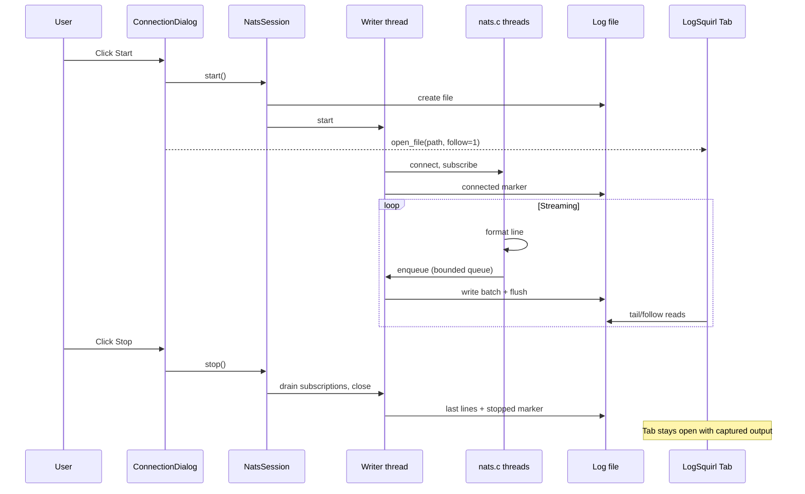
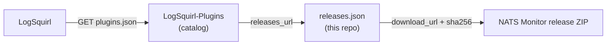

<!-- Allow GitHub's presentation markup and a logo before the main heading. -->
<!-- markdownlint-configure-file {"MD033": {"allowed_elements": ["div", "img"]}, "MD041": false} -->

<div align="center">


# NATS Monitor

**Every subject a line, every capture its own tab.**

**A [LogSquirl](https://github.com/64x-lunicorn/LogSquirl) plugin that streams
NATS messages into a live, searchable tab.**

Subscribe to subjects (with `*` and `>` wildcards), and every message lands as
one line — timestamp, subject, reply subject, size, headers, payload — in a
file LogSquirl follows, so its search, filters and highlighters work on live
traffic, also at high message rates.

[](https://github.com/64x-lunicorn/LogSquirl-NATS/actions/workflows/ci-build.yml)
[](https://github.com/64x-lunicorn/LogSquirl-NATS/releases/latest)
[](https://github.com/64x-lunicorn/LogSquirl-NATS/releases)
[](#install)
[](LICENSE)

[Install](#install) &nbsp;/&nbsp;
[Usage](#usage) &nbsp;/&nbsp;
[Line Format](#line-format) &nbsp;/&nbsp;
[Build](#build) &nbsp;/&nbsp;
[Architecture](#architecture) &nbsp;/&nbsp;
[Changelog](CHANGELOG.md)

</div>

---

## Why this plugin?

`nats sub` prints a few lines per message and scrolls away. Piping it to a
file gives you text you can search, but no columns, no reconnects, and no
idea what was dropped. This plugin puts the traffic where your other logs
already are.

| Less setup | More signal |
| :--- | :--- |
| **Every capture its own tab.** Each Start opens a followed LogSquirl tab; run as many sessions side by side as you like. | **One message, one line.** Timestamp, subject, reply subject, size, headers and payload, so a regex finds a message and the line shows all of it. |
| **Saved connections.** Server URLs, authentication and TLS saved as named profiles — never a password or token. | **Columns in the Table View.** A Log Format ships with the plugin: *timestamp, subject, reply, size, body*. |
| **Several subjects per session.** Wildcards, queue groups, and a warning when two subjects overlap. | **Nothing dropped silently.** A `dropped=` line marks every gap, and the status bar counts them. |
| **Nothing to install.** nats.c and OpenSSL are linked in: no NATS CLI, no system OpenSSL. | **Bounded files.** A capture goes on in a new file and tab at a size limit you choose. |

## Install

### From LogSquirl

*Plugins → Browse Plugins…* → **NATS Monitor** → **Install**. The archive is
downloaded, verified against its SHA-256 checksum and loaded — no file copying.

> The plugin is listed there from its first release, 0.1.0, on.

### From a release

Download the archive for your platform from the
[releases page](https://github.com/64x-lunicorn/LogSquirl-NATS/releases/latest)
and unpack it into LogSquirl's plugin directory:

| Platform | Plugin Directory |
|----------|-----------------|
| macOS    | `~/Library/Application Support/logsquirl/plugins/io.github.logsquirl.nats/` |
| Linux    | `~/.local/share/logsquirl/plugins/io.github.logsquirl.nats/` |
| Windows  | `%APPDATA%/logsquirl/plugins/io.github.logsquirl.nats/` |

### From source

See [Build](#build), then (macOS; `liblogsquirl_nats.so` on Linux,
`logsquirl_nats.dll` on Windows):

```bash
DEST="$HOME/Library/Application Support/logsquirl/plugins/io.github.logsquirl.nats"
mkdir -p "$DEST"
cp build/liblogsquirl_nats.dylib "$DEST/"
cp plugin.json icon.png formats/nats_log.json LICENSE NOTICE LICENSES/Apache-2.0.txt "$DEST/"
```

Or `cmake --install build --prefix <prefix>`, which copies the same files
into `<prefix>/share/LogSquirl/plugins/io.github.logsquirl.nats/` (set
`PLUGIN_INSTALL_DIR` for another directory).

After installing, restart LogSquirl or re-scan via *Plugins → Manage Plugins…*.

## Usage

<!-- screenshot: docs/images/dialog.png — the NATS Monitor dialog with a
     profile loaded, two subjects (one with a queue group), TLS on, and two
     sessions in the Running list. -->

> **Screenshot pending:** the NATS Monitor dialog. The screenshots of this
> README are taken when the plugin is first tried in LogSquirl 26.12.

1. **Enable the plugin** in *Plugins → Manage Plugins…* — check
   "NATS Monitor" and click OK.

2. **Open the dialog** with *Plugins → NATS Monitor…*. It is not modal: keep
   it open beside the tabs.

3. **Connect.**
   - **Server** — `nats://localhost:4222` by default. Several URLs,
     comma-separated, are the seeds of a cluster. A `tls://` URL connects
     with TLS.
   - **Authentication** — *No credentials*, *User and password*, *Token*,
     *Credentials file (.creds)* or *NKey seed file*. A password or token is
     entered in the dialog for each Start and never saved; a `.creds` file is
     the way to keep credentials without typing them.
   - **TLS** — check *Use TLS* (or use a `tls://` URL) to set the CA file, a
     client certificate and its key, and the server name the certificate
     must be for, if not the URL's host. *Skip the verification of the
     server's certificate* accepts any certificate: for testing only.
   - **Profile** — enter a name and **Save** to keep these settings; choose a
     profile from the list to fill them in again, **Delete** to remove it.
     Profiles are saved in `nats.ini` in the plugin's configuration
     directory, without passwords or tokens.

4. **Subjects** — one a line, with the wildcards `*` (one token) and `>`
   (the rest of the subject). A word after a subject is a queue group:

   ```text
   orders.>
   jobs.* workers
   ```

   A session in a queue group shares the messages with the group's other
   members, so it takes them away from them; leave it out to see
   everything. Subjects that overlap (`orders.>` and `orders.eu.*`) give one
   line per subscription for a message both match, as the server delivers
   it; the dialog warns, and suggests dropping the narrower one when the
   other covers it.

5. **Limits.**
   - **Binary payloads, first** — how many bytes of a payload that is not
     UTF-8 are written, as hex (256 by default).
   - **Pending at most** — how many messages and MiB nats.c holds for each
     subject before it drops as a slow consumer (1,000,000 and 512 MiB).
   - **New file at** — the size, in MiB, at which the capture goes on in a
     new file, opened in a new tab and noted in LogSquirl's log (256 MiB;
     *No limit* turns it off). A message line is never split. Remembered
     between sessions.

6. **▶ Start** — connects, subscribes, and opens the capture in a new tab in
   follow mode. Every Start adds a session beside those running, with its own
   connection, file and tab; the settings stay editable for the next one.
   The status line below shows each session's connection events and, when a
   connection fails, why, in words you can act on (the server refused the
   password, the server's certificate is not trusted, …).

7. **■ Stop** stops the session selected in *Running*, **Stop all** every
   one. The tabs keep what was captured.

   <!-- screenshot: docs/images/capture-tab.png — a followed capture tab with
        live messages, headers and a highlighter on one subject. -->

   > **Screenshot pending:** a capture tab following live traffic.

8. **The status bar** shows what runs:
   `NATS: 2 sessions · 1,234 msgs/s · 5 dropped`, or `NATS: no capture`. The
   dropped count is that of the running sessions; their files mark where.

   <!-- screenshot: docs/images/status-widget.png — LogSquirl's status bar
        with the NATS widget during a capture. -->

   > **Screenshot pending:** the status bar widget.

**Where the files are.** A capture is written to
`nats_<subjects>.log` (then `nats_<subjects>.2.log`, … after the size
limit; `orders.>` gives `nats_orders._.log`) in a temporary directory `logsquirl-nats-<pid>-XXXXXX`. The files stay
while LogSquirl runs, also after Stop, and are removed when it quits; copy
one elsewhere to keep it.

*Plugins → Manage Plugins… → Configure* has no settings yet: everything is in
the dialog.

### Screenshots still to take

The screenshots are taken when the plugin is first tried in LogSquirl 26.12;
until then each has a marked placeholder above or below:

| File | Shows |
|------|-------|
| `docs/images/dialog.png` | The dialog: a profile loaded, two subjects (one with a queue group), TLS on, two sessions running |
| `docs/images/capture-tab.png` | A followed capture tab with live messages, headers and a highlighter |
| `docs/images/status-widget.png` | The status bar widget during a capture |
| `docs/images/table-view.png` | The Table View with the plugin's columns |

## Line Format

One message per line, fields separated by one space:

```text
<UTC timestamp>             <subject>         <reply|-> <size> [<headers>] <payload>
2026-11-11 10:00:00.123456Z orders.eu.created _INBOX.ab12 20 {"id":1,"total":9.5}
2026-11-11 10:00:00.124001Z sensors.t1 - 4 [Nats-Msg-Id=42; Trace=abc] 21.5
2026-11-11 10:00:00.125000Z bin - 4 hex:0001feff
2026-11-11 10:00:02.000000Z $NATS-MONITOR - 28 dropped=1234 (slow consumer)
```

- **Timestamp** — when the plugin received the message, in UTC, with
  microseconds.
- **Subject**, **reply subject** (`-` for none) — NATS subjects contain no
  spaces, so these fields always parse.
- **Size** — the payload's size in bytes, also when the line shows only part
  of it.
- **Headers**, when there are any — `[k=v; k=v]`, sorted by key; `;`, `]`,
  `\` and line breaks are escaped by a backslash, and `=` in keys too.
- **Payload** — UTF-8 text as it is, with `\n`, `\r` and `\\` escaped and the
  other control characters but tab as `\xNN`, so one message is always one
  line; JSON stays as received. A leading `[` or `hex:` is escaped as well
  (`\x5B`, `\x68ex:`). Anything that is not UTF-8 is `hex:` and its bytes,
  cut at *Binary payloads, first*.
- **Marker lines** — what the plugin itself reports, with the subject
  `$NATS-MONITOR`, which no client can publish to: `connected to …,
  subscribed to …`, `disconnected`, `reconnected to …`, `connection to …
  failed: …`, `error: …`, `connection closed`, `stopped`, and `dropped=<n> (slow consumer)` or `dropped=<n> (queue full)` where
  messages were lost. Search for `$NATS-MONITOR` to find every event.

### Log Format and the Table View

The plugin ships the Log Format [`formats/nats_log.json`](formats/nats_log.json),
which gives LogSquirl's Table View these columns:

| Column | Holds |
|--------|-------|
| `timestamp` | The receive time (UTC) |
| `subject` | The subject; `$NATS-MONITOR` for a marker line. The identifier column |
| `reply` | The reply subject, `-` for none |
| `size` | The payload's size in bytes |
| `body` | The headers and the payload |

LogSquirl 26.12 and later read it while the plugin is enabled; with an older
version, import `nats_log.json` from the plugin directory. A line longer than
about 1 MB (a message with a large payload) gets no columns: LogSquirl does
not match longer lines.

<!-- screenshot: docs/images/table-view.png — the Table View of a capture
     with the timestamp, subject, reply, size and body columns. -->

> **Screenshot pending:** the Table View with the plugin's columns.

### Without the plugin

For a quick look at a server without installing anything, the
[NATS CLI](https://github.com/nats-io/natscli) can write to a file that
LogSquirl opens with *Follow*:

```bash
nats sub '>' > nats.log
```

It prints the headers by default. Each message then takes several lines
(`[#1] Received on "<subject>"`, the headers, the payload), with no
timestamp and no columns, and nothing marks messages dropped by a slow
consumer: enough for a glance, which is what the plugin is for beyond it.

## Prerequisites

- **LogSquirl** ≥ 26.10 with the plugin system enabled (≥ 26.12 for the Log
  Format to be picked up without importing it)
- **Qt6** (Core + Widgets; Network for the tests) — same version LogSquirl
  was built with
- **CMake** ≥ 3.28, and Ninja or make
- A C and C++17 compiler (GCC, Clang, MSVC x64)
- **Perl** and **make** to build OpenSSL; on Windows a native Perl such as
  Strawberry Perl and `nmake` from the MSVC environment

Nothing NATS- or OpenSSL-related needs to be installed: the build downloads
nats.c and OpenSSL at pinned, checksum-verified versions and links them in.

## Build

```bash
# Clone
git clone https://github.com/64x-lunicorn/LogSquirl-NATS.git
cd LogSquirl-NATS

# Configure (the first configure builds OpenSSL: a few minutes)
cmake -B build -S . -G Ninja -DCMAKE_BUILD_TYPE=Release

# If Qt6 is not in PATH (e.g. Homebrew on macOS):
cmake -B build -S . -G Ninja -DCMAKE_BUILD_TYPE=Release \
  -DCMAKE_PREFIX_PATH="$(brew --prefix qt6)"

# Build
cmake --build build

# The shared library is in build/:
#   macOS:   build/liblogsquirl_nats.dylib
#   Linux:   build/liblogsquirl_nats.so
#   Windows: build/logsquirl_nats.dll
```

### Running Tests

```bash
cmake -B build -S . -G Ninja -DCMAKE_BUILD_TYPE=Release -DBUILD_TESTS=ON
cmake --build build
ctest --test-dir build --output-on-failure
```

The test build downloads a `nats-server` release at a pinned version, so most
tests run against a real server; without one (offline), they are reported
as skipped. See [docs/DEVELOPER_GUIDE.md](docs/DEVELOPER_GUIDE.md#testing)
for the options, the test seams and the benchmark.

## Architecture

```mermaid
graph TD
    subgraph LogSquirl Host
        H[MainWindow]
        SB[Status bar]
    end

    subgraph Plugin — C ABI Boundary
        P[plugin.cpp<br/>get_info / init /<br/>shutdown / configure]
        D[ConnectionDialog<br/>profiles, subjects, limits,<br/>running sessions]
        SW[StatusWidget<br/>sessions · msgs/s · dropped]
        S1[NatsSession #1<br/>orders.>]
        S2[NatsSession #2<br/>jobs.* workers]
    end

    H -- "register_menu_action<br/>Plugins → NATS Monitor…" --> P
    P -- creates --> D
    P -- register_status_widget --> SW
    SW --> SB
    SW -- totals --> D
    D -- starts --> S1
    D -- starts --> S2
    S1 -- writes --> F1[nats_orders._.log]
    S2 -- writes --> F2[nats_jobs._.log]
    F1 -- open_file follow=1 --> H
    F2 -- open_file follow=1 --> H
```

### Data Flow



### Key Design Decisions

| Decision | Rationale |
|----------|-----------|
| **Plugin type = UI** | Several sessions, each with its own tab, a dialog and a status widget; as LogSquirl-Serial. |
| **open_file() instead of push_line()** | Each session writes its own file, which the host follows: LogSquirl's indexing of large growing files does the heavy lifting, and the capture survives Stop. |
| **nats.c, linked in statically** | The official C client: headers, NKeys and `.creds`, TLS, and JetStream for replay; no CLI to install. |
| **OpenSSL built by the plugin** | Static and the same on every platform, no system OpenSSL; [ADR 1](docs/adr/0001-static-openssl-built-by-the-plugin.md). |
| **Callbacks never block** | nats.c's threads only format and enqueue; one writer thread per session owns the file and writes in batches. |
| **Drops are lines** | A `dropped=` marker where the gap is, so the log itself shows what is missing. |
| **One line per subscription** | Overlapping subjects are written as the server delivers them; deduplicating would hide that. |
| **Secrets never saved** | Profiles hold no password or token; a `.creds` file keeps credentials on disk. |
| **No built-in filtering** | LogSquirl's regex search and highlighters do it better. |

The threads, the queue, the writer and the rotation are described in
[docs/DEVELOPER_GUIDE.md](docs/DEVELOPER_GUIDE.md#architecture); the plan and
the decisions behind them in [docs/PLAN.md](docs/PLAN.md).

## Project Structure

```text
LogSquirl-NATS/
├── CMakeLists.txt              # Standalone build — finds Qt6, builds the shared lib
├── plugin.json                 # Plugin manifest (cross-platform)
├── icon.svg, icon.png          # Plugin icon (the PNG rendered from the SVG)
├── LICENSE                     # GPL-3.0-or-later
├── LICENSES/Apache-2.0.txt     # Licence of nats.c and OpenSSL, linked in
├── NOTICE                      # Third-party notices
├── README.md                   # This file
├── CHANGELOG.md                # Release history
├── releases.json               # Versions, downloads and checksums for the catalog
├── cmake/
│   ├── Dependencies.cmake      # Pinned versions and SHA-256s
│   ├── OpenSSL.cmake           # Builds the static OpenSSL
│   ├── NatsC.cmake             # nats.c through FetchContent
│   ├── NatsServer.cmake        # The nats-server of the tests
│   └── CheckNoSharedOpenSSL.cmake
├── formats/
│   └── nats_log.json           # Log Format for the Table View
├── include/
│   └── logsquirl_plugin_api.h  # Vendored SDK header (MIT license)
├── src/
│   ├── plugin.h, plugin.cpp    # C ABI entry points, global state
│   ├── connectiondialog.*      # The dialog: connection, subjects, sessions
│   ├── natssession.*           # A capture: connection, subscriptions, queue, writer
│   ├── natsoptions.*           # Settings → nats.c options; failures in words
│   ├── authmethods.h           # The authentication methods, one table
│   ├── nkey.*                  # The public key of an NKey seed
│   ├── profiles.*              # Saved connection profiles
│   ├── subjects.*              # Subjects as entered, overlap check
│   ├── lineformat.*            # One message → one line
│   ├── statuswidget.*          # The status bar widget
│   └── tempdirs.*              # Temporary directories per process
├── tests/                      # Catch2 tests, most against a real nats-server
│   ├── certs/, auth/           # TLS and NATS credential fixtures
│   └── …
└── docs/
    ├── PLAN.md                 # Plan and decisions
    ├── DEVELOPER_GUIDE.md      # Architecture, build, tests
    └── adr/                    # Architecture decision records
```

## Plugin Registry

The plugin is to be listed in the
[LogSquirl-Plugins](https://github.com/64x-lunicorn/LogSquirl-Plugins) catalog
at its first release, so that it installs from **Plugins → Browse Plugins…**
with no manual file copying.

The catalog holds **one entry per plugin** and does not change between releases.
Versions, download URLs and checksums live in this repository's
[`releases.json`](releases.json): CI Release hands over each new entry with the
archives' SHA-256s, to be committed to `main` after the release. Every
`sha256` must be filled in: an empty checksum silently disables verification
in the host.



## License

GPL-3.0-or-later — see [LICENSE](LICENSE) for the full license text.

The plugin library contains nats.c and OpenSSL, both Apache-2.0, linked in
statically; their notices are in [NOTICE](NOTICE) and the licence text in
[LICENSES/Apache-2.0.txt](LICENSES/Apache-2.0.txt).

The vendored `include/logsquirl_plugin_api.h` header is MIT-licensed, so
plugins of any license can build against the LogSquirl Plugin SDK without
taking on GPL obligations.
